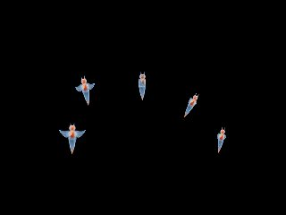

# Aquarium Clione ESP32

ESP32-C3 または ESP32-S3 + ST7789 (320×240 横向き) でクリオネの水槽を再現します。
起動するたびに1〜5匹がランダムな位置に現れ、12〜24時間に1回、餌の巻貝が現れて捕食します。
ターゲットの判定は `lgfx_setup.h` / ソース内の `CONFIG_IDF_TARGET_ESP32C3` で自動的に行われ、配線と描画経路が切り替わります。

## 配線 (ESP32-C3 Dev Module)

|ST7789|GPIO|
|-|-|
|SCLK / SCL|8|
|MOSI / SDA|10|
|DC|4|
|CS|5|
|RST / RES|3|
|VCC|3V3|
|GND|GND|

## 配線 (ESP32-S3 Dev Module)

|ST7789|GPIO|
|-|-|
|SCLK / SCL|12|
|MOSI / SDA|11|
|DC|9|
|CS|10|
|RST / RES|3V3に接続 (空きGPIOを割り当てる場合は `PIN_TFT_RST` を定義)|
|VCC|3V3|
|GND|GND|

`PIN_TFT_SCLK` / `PIN_TFT_MOSI` / `PIN_TFT_DC` / `PIN_TFT_CS` / `PIN_TFT_RST` / `PIN_TFT_BLK` / `TFT_SPI_FREQ` をビルド前に定義すればいずれのターゲットでも配線を変更できます。

## ビルド・書き込み

Arduino IDEで `Aquarium_Clione_ESP32.ino` を開き、以下を設定してください。

### ESP32C3 Dev Moduleの場合

- ボード: **ESP32C3 Dev Module**
- USB CDC On Boot: **Enabled**
- Flash: **4MB**
- Partition Scheme: **Huge APP (3MB No OTA/1MB SPIFFS)**
- ライブラリ: **LovyanGFX**

### ESP32-S3 Dev Module の場合

- ボード: **ESP32S3 Dev Module**
- USB CDC On Boot: **Enabled**
- USB Mode: **Hardware CDC and JTAG**
- Flash: **16MB**
- Partition Scheme: **16MB Flash(3MB APP/9.9MB FATFS)**
- PSRAM: **Enabled**
- ライブラリ: **LovyanGFX**

USBで接続したボードのポートを選び、書き込みます。

## シリアルコマンド (115200bps)

|コマンド|動作|
|-|-|
|FEED|餌を入れる|
|AUTO ON / AUTO OFF|自動給餌の切り替え|
|SHOW|状態・描画速度を表示|
|RESET|水槽を初期化 (匹数も再抽選)|
|REBOOT|再起動|
|HELP|コマンド一覧|

## ライセンス

本プロジェクトの著作権は mochimochi-man / Uh (X : calorie0) に帰属します。
MITライセンスですので、ご自由にお使いください。
クリオネの画像はAIで生成しました。
